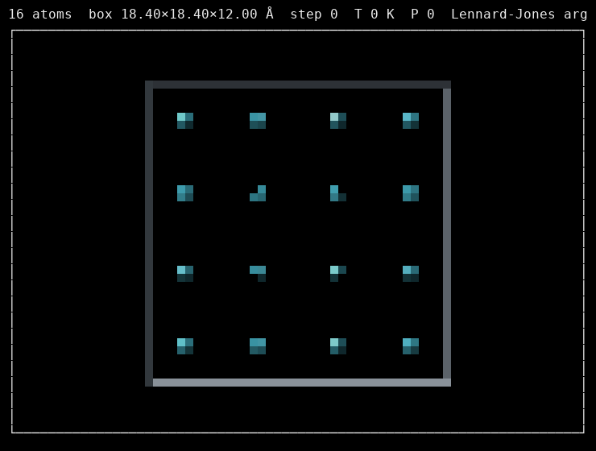

# termview



Terminal-only molecular and data visualizations for SSH and local terminals.
The animation above is an illustrative Lennard-Jones simulation, not a
terminal screenshot; the actual terminal modes are shown below.

## Install and quickstart

```sh
python -m pip install '.[ase]'     # from this checkout
termview examples/datasets/water.xyz
termview examples/datasets/water-motion.extxyz --lit --mode braille
termview examples/datasets/silicon.cif --record movie.cast
termview examples/datasets/series.csv
```

NumPy is required. ASE is an optional extra required for molecular file formats
and the toy simulation. The distribution is named `terminal-pixel-visualizer`;
the command and Python package remain `termview`. `termview` detects XYZ by contents, including arbitrary
extensions, and supports ASE XYZ/extxyz, CIF, VASP, PDB and trajectory files.
CSV and whitespace-separated numeric tables become scatter plots, or a
histogram for one column. The [example datasets](examples/datasets/) include
molecules, materials, trajectories, and tables.

Terminal size and colour support are detected automatically; override with
`--width`, `--height` and `--color truecolor|256|plain`. On a terminal,
trajectories play at `--fps` (default 10); redirected output contains the first
frame unless recording. `--follow` watches appended trajectory frames, and
`--record FILE` writes an asciinema v2 cast. Drag or use arrow keys to rotate
and press `q` or Ctrl-C to quit. Use `--no-mouse` to disable mouse reporting.

| Mode | Packing | Example |
| --- | --- | --- |
| `half` | Two full-colour vertical pixels per cell | [Screenshot](gallery/mode-half.png) |
| `quad` | Four quadrant pixels, one foreground colour | [Screenshot](gallery/mode-quad.png) |
| `braille` | Eight dots, one foreground colour | [Screenshot](gallery/mode-braille.png) |

Braille uses only **one colour per cell**, the most frequent colour among its
lit dots. Quadrants have the same limitation. A font with block and braille
glyphs is required. A 100×40 terminal or larger is recommended.

## Python library

```python
from ase.io import read
from termview import ElementStyle, RenderConfig, Renderer, DiffPrinter

config = RenderConfig(elements={8: ElementStyle((255, 70, 60), 0.30, 2)})
renderer = Renderer(config)
atoms = read("examples/datasets/water.xyz")
atoms.center(vacuum=3)  # supply a cell for a structure without one
print(renderer.render_lit(atoms, width=80, height=25))
printer = DiffPrinter(renderer)
printer.draw()
```

Renderers accept ASE-compatible `Atoms` objects independently of their origin.
The element table is configurable; defaults use common CPK colours, with a
neutral fallback for unlisted elements. `Renderer` owns its frame state;
multiple renderers do not share state. `termview.plot.Canvas` supplies braille
dots, lines and rows, and `termplot` offers `scatter`, `hist` and `report`:

```sh
termplot scatter examples/datasets/series.csv --header --x time --y energy --color phase
termplot hist examples/datasets/single-column.txt --centre
termplot report examples/datasets/series.csv --header --x time --y energy
```

Columns are zero-based unless `--header` supplies names. `--clip LO HI` filters
the x column; `--width` and `--height` control plot size.

## How it works

The lit renderer projects sphere impostors, reconstructs a surface normal at
each covered pixel, and applies ambient, diffuse and Blinn–Phong specular
lighting. A z-buffer resolves occlusion; bonds are rasterized as shaded
cylinders. NumPy vectorizes pixel calculations. The 2D renderer draws a moving
z-slab with dimmed out-of-slab atoms. Packing turns the pixel buffer into
half-block, quadrant or braille characters; `DiffPrinter` can redraw changed
cells only.

## Examples and development

Run the standalone qualitative toy MD example with
`python examples/toy_live.py --lit --steps 100`. It is for visualizing motion
and disorder, **not** quantitative results.

The [gallery](gallery/) includes a [Lennard-Jones animation](gallery/lennard-jones.gif),
[initial snapshot](gallery/lennard-jones-snapshot.png) and
[energy/temperature graphs](gallery/lennard-jones-energy.png). These use 16
argon atoms in a 2D periodic box, ASE's Lennard-Jones potential (ε = 0.0103 eV,
σ = 3.4 Å, smooth cutoff = 10.2 Å), velocity Verlet at 3 fs, and initial
60 K Maxwell-Boltzmann velocities with seed 42. The z and center-of-mass
motion are removed; the animation samples every 30 fs.

See [CONTRIBUTING.md](CONTRIBUTING.md) for tests and checks. MolTUI is an
inspiration for terminal molecular visualization; this implementation is
independently written. [MolTUI is MIT-licensed](https://github.com/kszenes/moltui/blob/master/LICENSE);
its licence and copyright notice must be retained if its code is incorporated.
# Terminal-Pixel-Visualizer
Software tool for viewing graphs, trajectories, images, animations as a pixelated terminal output.

Goal:
termmol/                    # pick a name
├── pyproject.toml
├── README.md               # GIF/screenshot at the top
├── LICENSE                 # MIT or Apache-2.0
├── CHANGELOG.md
├── src/termmol/
│   ├── __init__.py
│   ├── raster.py           # sphere impostors, z-buffer
│   ├── pack.py             # half-block / quad / braille packing
│   ├── render2d.py         # slab view (from mdview.render)
│   ├── render3d.py
│   ├── plot.py             # from termplot
│   ├── controls.py         # from termctl
│   └── cli.py              # from toy_live: `termmol traj.extxyz --lit`
├── examples/
├── tests/
└── .github/workflows/ci.yml

To do:
--Example images.
